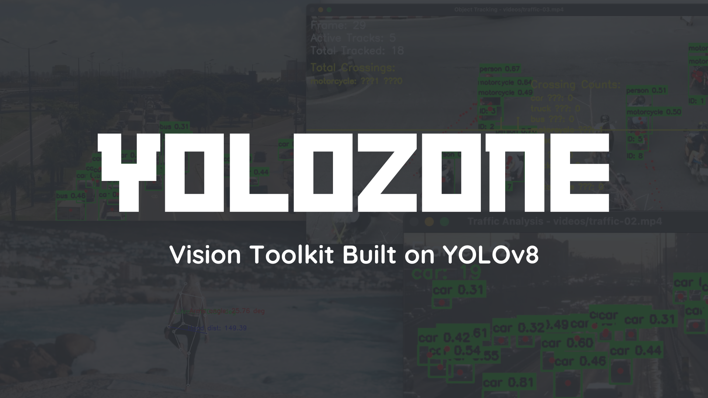

<!-- Image Banner -->


# YoloZone

YoloZone is a powerful computer vision toolkit built on YOLOv8, providing intuitive interfaces for object detection, pose estimation, object tracking, hand tracking, face tracking, and spatial video analytics. It simplifies complex computer vision tasks with easy-to-use APIs and comprehensive documentation.

[](https://pypi.org/project/yolozone/)
[](https://nushankodikara.github.io/yolozone/)
[](features.md)
[](https://github.com/nushankodikara/)
[](https://www.linkedin.com/in/nushan-kodikara/)

> 📖 **Looking for a full breakdown of every capability? Check out the [Features Guide](features.md).**

## Features

### Object Detection
- Detect and classify objects in images and videos with YOLOv8
- Support for custom models (`.pt`) and multiple detection strategies
- Real-time processing capabilities with CPU, CUDA, and Apple Silicon MPS support
- Configurable confidence thresholds, class filtering, and centroid extraction

### Pose Estimation
- Advanced human pose detection and 17-point keypoint analysis
- Real-time pose tracking across single or multiple people
- Joint angle measurements (`angle_between_3_points`)
- Keypoint Euclidean distance measurements (`distance_between_2_points`)
- Angular orientation between limbs (`angle_between_2_lines`)
- Skeleton rendering and connectivity checks

### Object Tracking
- Robust multi-object tracking (MOT) across video frames
- Motion pattern analysis and historical trajectory generation
- Directional line crossing detection with cumulative counters
- Active and inactive track lifecycle management

### Hand Tracking Helpers
- Pose-assisted and model-based hand localization
- Left and right hand bounding box derivation
- Raised hand detection (`is_hand_raised`)
- Hand-to-hand distance and clapping detection (`is_clapping`)
- Side-to-side hand waving gesture detection (`is_waving`)
- Hand velocity and movement speed metrics

### Face Tracking Helpers
- 5-point facial landmarks (Nose, Left Eye, Right Eye, Left Ear, Right Ear)
- Adaptive face bounding box estimation
- Head roll angle (tilt) and yaw ratio (orientation) estimation
- Inter-ocular distance measurement for scale/proximity
- Persistent face tracking with unique IDs (`FaceTracker`)
- Face cropping utility (`crop_face`)

### Spatial Tracking Helpers
- **`ZoneTracker`**: Region of Interest (ROI) polygon/rect occupancy, entry/exit counters, and dwell time
- **`LineCrossingHelper`**: Multi-line bi-directional crossing management
- **`SpeedEstimator`**: Calibrated real-world speed calculation (km/h, m/s)
- **`TrajectoryVisualizer`**: Smooth motion trails and 2D spatial flow heatmaps

## Installation

```bash
pip install yolozone
```

## Quick Start

### Object Detection
```python
from yolozone import ObjectDetector

# Initialize detector
detector = ObjectDetector(model="yolov8s.pt")

# Detect objects in an image
results = detector.detect_objects('image.jpg', conf=0.3)

# Draw detections
img, detections = detector.draw_detections(image, results, classes=['car', 'person'])
```

### Pose Estimation
```python
from yolozone import PoseDetector

# Initialize pose estimator
pose = PoseDetector(model="yolov8s-pose.pt")

# Find keypoints
keypoints = pose.find_keypoints(frame)

# Calculate elbow flexion angle (5: Shoulder, 7: Elbow, 9: Wrist)
angle, text, text_pos = pose.angle_between_3_points(keypoints, 5, 7, 9)
```

### Hand & Gesture Tracking
```python
from yolozone import HandTracker

tracker = HandTracker()
tracked_hands = tracker.update(frame, keypoints=keypoints)

# Render hands and detect waving gestures
frame = tracker.draw_tracks(frame, tracked_hands, draw_trails=True, draw_gestures=True)
```

### Face Tracking & Head Orientation
```python
from yolozone import FaceTracker

face_tracker = FaceTracker()
tracked_faces = face_tracker.update(frame, keypoints=keypoints)

for face in tracked_faces:
    print(f"Face #{face['face_id']} - Roll: {face['roll_deg']:.1f} deg, Yaw: {face['yaw_ratio']:+.2f}")
```

### Object Tracking & Line Crossing
```python
from yolozone import ObjectDetector

detector = ObjectDetector(model="yolov8n.pt")
results = detector.detect_objects(frame, track=True)
tracks = detector.tracker.update(results)
frame = detector.tracker.draw_tracks(frame, tracks, draw_trails=True)
```

## Keypoint Reference

The pose estimation module uses the standard 17 COCO keypoints:

| ID | Keypoint | ID | Keypoint |
|----|----------|----|----------|
| 0 | Nose | 9 | Left Wrist |
| 1 | Left Eye | 10 | Right Wrist |
| 2 | Right Eye | 11 | Left Hip |
| 3 | Left Ear | 12 | Right Hip |
| 4 | Right Ear | 13 | Left Knee |
| 5 | Left Shoulder | 14 | Right Knee |
| 6 | Right Shoulder | 15 | Left Ankle |
| 7 | Left Elbow | 16 | Right Ankle |
| 8 | Right Elbow | | |

## Documentation

Visit our [comprehensive documentation](https://nushankodikara.github.io/yolozone/) for detailed API references, visual examples, and tutorials.

For an extensive module feature list, see [features.md](features.md).

## Requirements

- Python 3.8+
- ultralytics (YOLOv8)
- opencv-python
- numpy

## Contributing

Contributions are welcome! Please feel free to submit a Pull Request.

## License

This project is licensed under the MIT License - see the LICENSE file for details.

## Author

- **Nushan Kodikara**
  - GitHub: [@nushankodikara](https://github.com/nushankodikara)
  - LinkedIn: [Nushan Kodikara](https://www.linkedin.com/in/nushan-kodikara/)
  - Email: nushankodi@gmail.com
