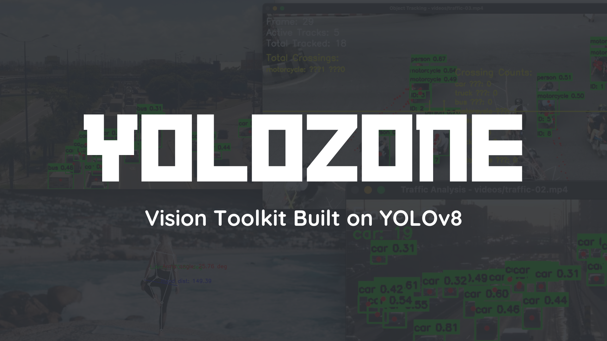

# YoloZone - Features & Capability Guide



**YoloZone** is an intuitive, high-performance computer vision toolkit built on top of **YOLOv8, YOLOv9, YOLOv10, YOLO11**, **OpenCV**, and **NumPy**. It provides streamlined, production-ready interfaces for object detection, human pose estimation, multi-object tracking, 21-point hand & finger tracking, 3D mathematical face plane mapping, emotion analysis, spatial video analytics, and custom object fine-tuning.

---

## Table of Contents

1. [Features Overview](#features-overview)
2. [Python & YOLO Model Support Matrix](#1-python--yolo-model-support-matrix)
3. [Object Detection (`ObjectDetector`)](#2-object-detection-objectdetector)
4. [Pose Estimation (`PoseDetector`)](#3-pose-estimation-posedetector)
5. [Object Tracking (`ObjectTracker`)](#4-object-tracking-objecttracker)
6. [Hand & 21-Finger Tracking (`HandDetector` & `HandTracker`)](#5-hand--21-finger-tracking-handdetector--handtracker)
7. [Face Mathematical Plane & Emotion Analysis (`FaceDetector` & `FaceTracker`)](#6-face-mathematical-plane--emotion-analysis-facedetector--facetracker)
8. [Object Training & Dataset Helper (`ObjectTrainer` & `DatasetHelper`)](#7-object-training--dataset-helper-objecttrainer--datasethelper)
9. [Spatial Analytics & Tracking Helpers](#8-spatial-analytics--tracking-helpers)
   - [Zone Tracker / ROI (`ZoneTracker`)](#zonetracker)
   - [Multi-Line Crossing (`LineCrossingHelper`)](#linecrossinghelper)
   - [Speed & Velocity Estimation (`SpeedEstimator`)](#speedestimator)
   - [Heatmap & Trajectory Visualizer (`TrajectoryVisualizer`)](#trajectoryvisualizer)
10. [Stock Test Videos Reference](#9-stock-test-videos-reference)
11. [Hardware Acceleration & Device Support](#10-hardware-acceleration--device-support)
12. [API Quick Reference](#11-api-quick-reference)

---

## Features Overview

| Feature Module | Key Capabilities | Primary Use Cases |
|---|---|---|
| **`ObjectDetector`** | Bounding box localization, multi-class classification, class filtering, object counting, center coordinate computation, YOLO-World custom vocabulary. | Inventory monitoring, traffic surveillance, robotics perception. |
| **`PoseDetector`** | 17-point COCO keypoint estimation, 3-point angle computation, 2-point distance calculation, 2-line angle analysis, skeleton drawing. | Fitness form evaluation, physiotherapy, sports analytics, ergonomics. |
| **`ObjectTracker`** | Multi-object tracking (MOT), trajectory trail drawing, directional line-crossing counters, lifetime & displacement stats. | Vehicle counting, footfall tracking, queue management. |
| **`HandDetector` & `HandTracker`** | **21-landmark hand kinematic topology**, individual finger poses (thumb, index, middle, ring, pinky), flexion angles, pinching, clapping, waving, and gesture recognition. | Human-computer interaction (HCI), touchless control, sign language, virtual interfaces. |
| **`FaceDetector` & `FaceTracker`** | **3D mathematical face plane mapping (solvePnP)**, face normal vector ($\vec{N}$), dense facial landmarks, head pose (pitch/yaw/roll), EAR/MAR expressions, and multi-emotion classification. | Attention monitoring, driver alertness, emotion detection, avatar rigging, framing. |
| **`ObjectTrainer` & `DatasetHelper`** | Directory structuring (`images/train`, `labels/train`), normalized YOLO bbox conversion, `data.yaml` generation, and one-click model fine-tuning. | Adding new custom items and domain-specific objects to YOLO models. |
| **`ZoneTracker`** | Polygonal and rectangular Region of Interest (ROI) monitoring, real-time occupancy, dwell time tracking, entry/exit callbacks. | Restricted area surveillance, retail customer dwell time, safety zones. |
| **`LineCrossingHelper`** | Multi-line counting manager, bi-directional tallying (In/Out), per-class categorization, HUD overlays. | Toll gates, store entrances, highway traffic monitoring. |
| **`SpeedEstimator`** | Pixel-to-meter calibrated velocity calculation, moving average smoothing, speed labeling in km/h or m/s. | Speed limit enforcement, athletic sprint tracking, conveyor belts. |
| **`TrajectoryVisualizer`** | Historical motion trail fading, motion direction vectors, 2D cumulative spatial heatmaps. | Store layout heatmaps, traffic flow density, animal behavior studies. |

---

## 1. Python & YOLO Model Support Matrix

### Python Version Support
YoloZone is fully compatible and tested across modern Python versions:
- **Python 3.8, 3.9, 3.10, 3.11, 3.12, 3.13**

### YOLO Model Family Support
YoloZone provides unified model loading, normalization, and inference across all major YOLO architectures:

| Family | Supported Models | Description |
|---|---|---|
| **YOLOv8** | `yolov8n`, `yolov8s`, `yolov8m`, `yolov8l`, `yolov8x` | Standard, proven YOLOv8 detection & pose models. |
| **YOLOv8-Pose** | `yolov8n-pose`, `yolov8s-pose`, `yolov8m-pose`, `yolov8l-pose`, `yolov8x-pose` | 17-keypoint human pose estimation. |
| **YOLOv9** | `yolov9t`, `yolov9s`, `yolov9m`, `yolov9c`, `yolov9e` | Programmable Gradient Information (PGI) architecture. |
| **YOLOv10** | `yolov10n`, `yolov10s`, `yolov10m`, `yolov10b`, `yolov10l`, `yolov10x` | NMS-free dual-label assignment models for ultra-low latency. |
| **YOLO11** | `yolo11n`, `yolo11s`, `yolo11m`, `yolo11l`, `yolo11x` | Latest YOLO11 state-of-the-art vision models. |
| **YOLO11-Pose** | `yolo11n-pose`, `yolo11s-pose`, `yolo11m-pose`, `yolo11l-pose`, `yolo11x-pose` | Next-generation pose estimation. |
| **YOLO-World** | `yolov8s-world`, `yolov8m-world`, `yolov8l-world`, `yolov8x-world` (v1 & v2) | Zero-shot open-vocabulary detection (`set_classes()`). |
| **Custom Models** | Any user-trained `.pt` weights file | Seamlessly fine-tuned via `ObjectTrainer`. |

```python
from yolozone import ObjectDetector, list_supported_models

# List all supported models
print(list_supported_models("yolo11"))

# Automatically normalizes and loads YOLO11 or YOLOv10
detector = ObjectDetector(model="yolo11s")
print(detector.model_info)  # {'family': 'yolo11', 'task': 'detect', 'size': 'small', ...}
```

---

## 2. Object Detection (`ObjectDetector`)

```python
import cv2
from yolozone import ObjectDetector

detector = ObjectDetector(model="yolov8s.pt")
image = cv2.imread("traffic.jpg")

# Detect objects with custom confidence
results = detector.detect_objects(image, conf=0.35, device="cpu")

# Count detected classes
counts = detector.count_objects(results, classes=['car', 'truck', 'motorcycle'])

# Draw annotations
annotated_img, detections = detector.draw_detections(image, results, classes=['car', 'truck'])
```

---

## 3. Pose Estimation (`PoseDetector`)

```python
import cv2
from yolozone import PoseDetector

pose = PoseDetector(model="yolov8s-pose.pt")
frame = cv2.imread("squat.jpg")

keypoints = pose.find_keypoints(frame)

# 1. Joint angle calculation (e.g. knee flexion: Hip 11, Knee 13, Ankle 15)
angle, text, text_pos = pose.angle_between_3_points(keypoints, 11, 13, 15, subject_index=0)

# 2. Skeleton drawing
circles, lines = pose.draw_pose(keypoints, subject_index=0)
```

---

## 4. Object Tracking (`ObjectTracker`)

```python
from yolozone import ObjectDetector
import cv2

detector = ObjectDetector("yolov8n.pt")
cap = cv2.VideoCapture("videos/traffic-01.mp4")

while cap.isOpened():
    ret, frame = cap.read()
    if not ret:
        break
    results = detector.detect_objects(frame, track=True)
    tracks = detector.tracker.update(results)
    frame = detector.tracker.draw_tracks(frame, tracks, draw_trails=True)
```

---

## 5. Hand & 21-Finger Tracking (`HandDetector` & `HandTracker`)

The Hand module provides full kinematic tracking of **21 landmarks** per hand, tracks the state of each finger, measures flexion angles, detects pinching, and classifies gestures.

### 21 Hand Landmark Topology
```
0: Wrist
1-4:   Thumb  (CMC: 1, MCP: 2, IP: 3, TIP: 4)
5-8:   Index  (MCP: 5, PIP: 6, DIP: 7, TIP: 8)
9-12:  Middle (MCP: 9, PIP: 10, DIP: 11, TIP: 12)
13-16: Ring   (MCP: 13, PIP: 14, DIP: 15, TIP: 16)
17-20: Pinky  (MCP: 17, PIP: 18, DIP: 19, TIP: 20)
```

### Finger Pose Capabilities
- **Finger State**: Evaluates `extended`, `curled`, or `half_curled` for Thumb, Index, Middle, Ring, and Pinky.
- **Joint Flex Angles**: Calculates the angular bending at each finger's PIP joint.
- **Pinch Detection**: Tracks the Euclidean distance between Thumb TIP and Index TIP (`pinch_distance` and `is_pinching`).
- **Gesture Classification**: Classifies `open_palm`, `fist`, `pointing`, `peace`, `thumbs_up`, `rock_horns`, `ok_sign`, and `pinch`.
- **Waving & Raised Hand**: Detects side-to-side hand waving oscillations and hands raised above shoulder.

```python
from yolozone import HandTracker, PoseDetector
import cv2

pose = PoseDetector("yolov8s-pose.pt")
tracker = HandTracker()

cap = cv2.VideoCapture("videos/hand-gesture-01.mp4")
while cap.isOpened():
    ret, frame = cap.read()
    if not ret:
        break

    kp = pose.find_keypoints(frame)
    tracked_hands = tracker.update(frame, keypoints=kp)

    for hand in tracked_hands:
        print(f"Hand {hand['type']}: Gesture={hand['gesture']}, Pinching={hand['is_pinching']}")
        for fname, fdata in hand['fingers'].items():
            print(f"  {fname.capitalize()}: {fdata['state']} (angle: {fdata['flex_angle']:.1f}°)")

    frame = tracker.draw_tracks(frame, tracked_hands, draw_skeleton=True, draw_gestures=True)
    cv2.imshow("Hand & Finger Tracking", frame)
    if cv2.waitKey(1) & 0xFF == ord('q'):
        break
```

---

## 6. Face Mathematical Plane & Emotion Analysis (`FaceDetector` & `FaceTracker`)

The Face module computes an exact 3D mathematical face plane using **Perspective-n-Point (`solvePnP`)**, extracts dense facial landmarks, projects orientation vectors, and analyzes expressions and emotions.

### Mathematical Plane Mapping
- **Camera Calibration & SolvePnP**: Computes 3D rotation vector $\vec{r}$ and translation vector $\vec{t}$ from canonical 3D facial coordinates.
- **Plane Equation**: Computes the 3D plane equation:
  $$A x + B y + C z + D = 0$$
- **Plane Normal Vector**: Projects the 3D normal vector $\vec{N}$ pointing perpendicularly out of the nose onto the screen.
- **Head Pose**: Returns exact head Euler angles: **Pitch** (nodding), **Yaw** (turning), and **Roll** (tilting).

### Expression & Emotion Analysis
- **Eye Aspect Ratio (EAR)**: Computes eye openness, detects blinking and winking.
- **Mouth Aspect Ratio (MAR)**: Computes mouth openness (talking, yawning, surprise).
- **Smile Curvature Index**: Measures upward curvature of mouth corners relative to center lips.
- **Emotion Probabilities**: Evaluates normalized scores for `happy`, `neutral`, `surprised`, `sad`, and `angry`.

```python
from yolozone import FaceTracker, PoseDetector
import cv2

pose = PoseDetector("yolov8s-pose.pt")
face_tracker = FaceTracker()

cap = cv2.VideoCapture("videos/face-emotion-01.mp4")
while cap.isOpened():
    ret, frame = cap.read()
    if not ret:
        break

    kp = pose.find_keypoints(frame)
    tracked_faces = face_tracker.update(frame, keypoints=kp)

    for face in tracked_faces:
        plane = face['plane']
        print(f"Face #{face['face_id']}:")
        print(f"  Plane Normal: {plane['plane_normal']}")
        print(f"  Head Pose: Pitch={plane['pitch_deg']:.1f}°, Yaw={plane['yaw_deg']:.1f}°, Roll={plane['roll_deg']:.1f}°")
        print(f"  Primary Emotion: {face['primary_emotion']} ({face['emotions'][face['primary_emotion']]*100:.0f}%)")
        print(f"  Active Expressions: {face['expressions']}")

    frame = face_tracker.draw_tracks(frame, tracked_faces, draw_plane=True, draw_trails=True)
    cv2.imshow("Face Plane & Emotion Analysis", frame)
    if cv2.waitKey(1) & 0xFF == ord('q'):
        break
```

---

## 7. Object Training & Dataset Helper (`ObjectTrainer` & `DatasetHelper`)

Adding new custom objects to detect in YOLO models is streamlined into a few simple steps.

### Workflow
1. **Initialize Dataset**: Creates `images/train`, `images/val`, `labels/train`, `labels/val`, and `data.yaml`.
2. **Add Samples**: Accepts raw frames and pixel bounding boxes; automatically converts to normalized YOLO coordinates (`class cx cy w h`).
3. **Train / Fine-Tune**: One-click fine-tuning on any base model (`yolov8n.pt`, `yolo11s.pt`, etc.).
4. **Export & Deploy**: Export to ONNX, TensorRT, or CoreML.

```python
from yolozone import DatasetHelper, ObjectTrainer
import cv2

# 1. Initialize dataset structure and data.yaml
dataset = DatasetHelper("drone_dataset", classes=["drone", "package"])

# 2. Add annotated frames (pixel coordinates: x1, y1, x2, y2)
cap = cv2.VideoCapture("videos/training-sample-01.mp4")
while cap.isOpened():
    ret, frame = cap.read()
    if not ret:
        break
    dataset.add_sample(frame, [("drone", (150, 100, 230, 160))])
cap.release()

print(dataset.get_summary())

# 3. Fine-tune model
trainer = ObjectTrainer(base_model="yolov8n.pt", dataset=dataset)
results = trainer.train(epochs=30, imgsz=640, device="cpu")

print("Best fine-tuned weights:", results["best_weights"])

# 4. Export to ONNX
onnx_path = trainer.export(format="onnx")
print("Exported ONNX model:", onnx_path)
```

---

## 8. Spatial Analytics & Tracking Helpers

### ZoneTracker
Tracks occupancy, dwell times, and entry/exit events for arbitrary polygon or rectangular regions of interest (ROI).

```python
from yolozone import ZoneTracker

zone = ZoneTracker([(100, 100), (400, 100), (450, 400), (100, 400)], name="Restricted Zone")
zone_summary = zone.update(tracks)
zone.draw(frame, color=(0, 0, 255), alpha=0.3, draw_stats=True)
```

### LineCrossingHelper
Manages multiple counting lines with directional tracking (In vs Out).

```python
from yolozone import LineCrossingHelper

line_helper = LineCrossingHelper()
line_helper.add_line("Entry Gate", (200, 300), (600, 300))
new_crossings = line_helper.update(tracks)
line_helper.draw(frame)
```

### SpeedEstimator
Calculates velocity based on camera calibration factors and video frame rate.

```python
from yolozone import SpeedEstimator

speed_est = SpeedEstimator(pixels_per_meter=20.0, fps=30.0)
speed_est.draw_speeds(frame, tracks, unit="km/h")
```

### TrajectoryVisualizer
Renders cumulative spatial heatmaps and smooth motion paths.

```python
from yolozone import TrajectoryVisualizer

visualizer = TrajectoryVisualizer(frame_shape=(720, 1280), decay=0.98)
visualizer.update(tracks)
heatmap_frame = visualizer.get_heatmap(base_img=frame, alpha=0.4)
```

---

## 9. Stock Test Videos Reference

The repository includes stock video files to test and validate every capability:

| Video File | Resolution & FPS | Target Capabilities Tested |
|---|---|---|
| `videos/stock-face-headpose.mp4` | 1920x1080 @ 30fps | Real human face detection, 3D solvePnP plane normal, head tilt/yaw/roll, emotion tracking. |
| `videos/stock-hand-gestures.mp4` | 1920x1080 @ 30fps | Multi-person hand gestures, 21 kinematic finger landmarks, raised hands. |
| `videos/stock-driver-gestures.mp4` | 1920x1080 @ 30fps | Real-world driver actions, steering wheel hands, face-touching gestures. |
| `videos/hand-gesture-01.mp4` | 640x480 @ 24fps | 21-point hand tracking, finger poses, waving gestures, flexion angles. |
| `videos/face-emotion-01.mp4` | 640x480 @ 24fps | 3D mathematical face plane, head roll tilt, yaw orientation, smile/emotion. |
| `videos/training-sample-01.mp4` | 640x480 @ 24fps | Custom object collection, dataset generation, sample annotation. |
| `videos/exercise-01.mp4` | 1920x1080 @ 24fps | Multi-person pose estimation, joint angle calculation, hand distance. |
| `videos/exercise-02.mp4` | 1920x1080 @ 24fps | Fitness form tracking, arm spread, body symmetry. |
| `videos/traffic-01.mp4` | 960x540 @ 30fps | Vehicle detection, object counting, centroid extraction. |
| `videos/traffic-02.mp4` | 960x540 @ 30fps | Multi-vehicle tracking, line crossing detection, velocity analysis. |

---

## 10. Hardware Acceleration & Device Support

YoloZone supports automatic and manual hardware acceleration:
- **NVIDIA GPU (CUDA)**: `device="cuda"` (or `"cuda:0"`)
- **Apple Silicon (Metal MPS)**: `device="mps"` (macOS M1/M2/M3/M4)
- **CPU**: `device="cpu"`

---

## 11. API Quick Reference

```python
import yolozone

from yolozone import (
    # Core Vision Modules
    ObjectDetector,         # Detection across YOLOv8, v9, v10, 11, world
    PoseDetector,           # 17-point human pose estimation
    ObjectTracker,          # Multi-object tracking (MOT)

    # Hand & Finger Tracking
    HandDetector,           # 21-landmark hand kinematic topology
    HandTracker,            # Finger poses, flexion angles, pinching, gestures

    # Face & Mathematical Plane
    FaceDetector,           # 3D plane projection, dense landmarks, emotions
    FaceTracker,            # Head pose, orientation vector, emotion HUD

    # Object Training Helper
    ObjectTrainer,          # One-click model fine-tuning and export
    DatasetHelper,          # Directory setup, YOLO bbox normalization, data.yaml

    # Spatial Analytics Helpers
    ZoneTracker,            # ROI polygon occupancy and dwell tracking
    LineCrossingHelper,     # Multi-line directional crossing counters
    SpeedEstimator,         # Velocity estimation (km/h, m/s)
    TrajectoryVisualizer,   # Trajectory trails and density heatmaps

    # Model Registry
    list_supported_models,  # List available YOLO model architectures
    identify_model_family,  # Model metadata parser
)

print(yolozone.__version__)  # "0.1.0"
```

---

## Versioning & Metadata

Version configuration is available in [**`simpleversion.json`**](simpleversion.json).

## License

YoloZone is licensed under the [MIT License](LICENSE). Built with ❤️ by [Nushan Kodikara](https://github.com/nushankodikara).
